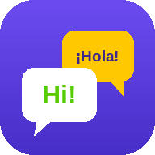

# Polyglot Game Master



Learn **Spanish** (for English speakers), **English** (for Spanish speakers), or **French**, **Portuguese**, **Mandarin Chinese** and **Arabic** (for English speakers) with mini-games.
Free, open source, works offline. No account, no ads, no tracking.

**▶ Play now: https://doonoo.github.io/polyglot-game-master/** · **📱 [Android app (APK)](https://github.com/doonoo/polyglot-game-master/releases/download/latest/PolyglotGameMaster.apk)**

## Get it

- **Android:** download [`PolyglotGameMaster.apk`](https://github.com/doonoo/polyglot-game-master/releases/download/latest/PolyglotGameMaster.apk) from the [latest build](../../releases/tag/latest) and open it on your phone. (Android asks you to allow installs from your browser or file manager the first time.) New versions install over the old one and keep your progress.
- **Android with automatic updates:** install [Obtainium](https://github.com/ImranR98/Obtainium) (free and open source), then [tap here to add Polyglot](https://apps.obtainium.imranr.dev/redirect?r=obtainium://add/https://github.com/doonoo/polyglot-game-master) or add `https://github.com/doonoo/polyglot-game-master` by hand. Obtainium checks this repo's releases and installs each new version.
- **iPhone:** open the [web app](https://doonoo.github.io/polyglot-game-master/) in Safari, then **Share → Add to Home Screen**.
- **PC / Mac:** open the [web app](https://doonoo.github.io/polyglot-game-master/) in Chrome, Edge or Brave and click the install icon in the address bar to get it as a desktop app. Edge has the most natural voices.
- Everything works offline after the first visit.

## What's inside

- **Full CEFR levels (A1 to B2):** every level covers grammar, everyday topics (food, home, travel, work, health, media, society...) and communication (introducing yourself, ordering, directions, invitations, opinions, complaints, formal emails...). Practice mode teaches each lesson, then brings it back until you recall it twice, and mixes in verb, tricky-pair and number drills.
- **8-bit sound effects:** NES-style effects built from the same chip voices as the soundtrack: a stage-clear fanfare when you beat a level, a game-over tune when you lose, and sounds for combos, lost hearts, stars, unlocks, tiles, matched pairs, badges, loot and every part of a boss fight. The 🔊 sound switch turns them off.
- **Six languages:** Spanish and English both ways, plus French, Portuguese, Mandarin Chinese and Arabic as full courses taught through English (levels A1–B1). Every mode works in every language, fitted to it: Numbers use each language's own number words, clock and money; Conjugation drills real French, Portuguese and Arabic verb tables (in Mandarin, whose verbs don't change, it becomes **Measure Words**: 个, 本, 张, 了, 过); Tricky Pairs covers each language's classic confusions (tu/vous, ser/estar, 不/没, هذا/هذه); plus Vocab, Island Hopper, Custom and two stories per language. Mandarin shows pinyin and Arabic shows transliteration; you can tap tiles or type in plain letters (Chinese ignores tones and spaces, Arabic ignores vowel marks), and Arabic is laid out right to left.
- **🦁 Leo, your Game Master:** a lion mascot and app icon. Leo sits on the main menu (tap him for a hello in another language), cheers on right answers, winks at small typos, looks sad on misses and shows up on the end screen.
- **Multiple-choice mini-games:** 🔘 Quick Pick (pick the right translation), 💡 Meaning Match (pick what it means), ✅ Right or Wrong (is this sentence correct?) and 🔎 Spot the Mistake (find the sentence with the error) rotate in with the typing games in Practice, Level Select, Survivor, Vocab, Conjugation, Tricky Pairs and Custom. After a Right or Wrong or Spot the Mistake answer, the card shows the sentence with the mistake crossed out and the correct version highlighted.
- **More tap mini-games:** 🧩 Gap Fill (pick the missing word), 🔀 Order Up (pick the sentence in the right order), ⚖️ Meaning Check (does it mean this?), 🔢 Number Pick and 🔣 Number Match (digits ↔ words) in Numbers, and 👤 Who's Doing It? and 🕵️ Tense Detective (who does it, which tense) in Conjugation. They play in every language.
- **Made for phones:** on a phone the answer box, accent keys and Submit sit in a bar at the bottom of the screen. After a right answer the card shrinks to one line and the next question is right there; with a clock on (Brisk, Blitz, Time Attack) lessons fold to one line and the keyboard stays up.
- **🔘 Multiple choice:** switch the menu's answer mode from Type to Multiple choice and every round gives 4 answers to tap (keys 1-4 on a computer). Works in every mode, every language and in 2-player games. Wrong options are near misses (the classic learner mistake, a swapped word, a wrong ending) and are checked so only one answer is ever right.
- **🔍 Display size:** make the whole app bigger or smaller (70% to 150%) from the 🔍 button on the menu or the A−/A+ row in the game's 🎛️ settings. It stacks on top of your phone's own text size.
- **Typo allowance:** a one-letter slip in a typed answer still counts and shows the right spelling. Wrong endings, real words and the planted mistake in Error Hunter don't count as typos, and Survivor, Tricky Pairs and boss fights stay strict.
- **👥 Two players in every mode:** switch the menu from 1 player to 2 players and any mode becomes a hot-seat game on one phone or one computer. Each player picks their own course and level, so a Spanish learner and an English learner can play each other. Turns alternate after each answer; each player keeps their own hearts, streak, XP, bosses, island and clock. Practice-style modes run a set number of turns each, Survivor is last one standing, Island Hopper is a race to finish. On phones a pass-the-phone screen hides the next question between turns; on a computer the two scoreboards sit beside the game and Enter moves things along. The single-player game and stats are left untouched.
- **Stories:** 32 short bilingual stories (A1 to B2) with comprehension questions and audio.
- **Daily quests and a daily challenge**, streaks, XP and trophies.
- **Game modes:** Practice, Level Select, Survivor, Number Cruncher, Lexicon Onslaught, Island Hopper (25 topics of phrases about your own life), Conjugation Gym and Tricky Pairs (ser/estar, por/para, este/esto/aquel…).
- **Listening:** tap 🔊 to hear any sentence with the device's own text-to-speech voices.
- **Dictation (where supported):** a 🎤 button in the answer box lets you say your answer instead of typing it. Listening (Echo Chamber) and speaking (Speak Up) rounds were removed in 2.10.1.
- **Idioms and slang:** everyday idioms (B1), body and animal idioms (B2), and regional slang (B2). For Spanish that means Mexico, Spain, Argentina, Colombia and the Caribbean; for English, the US and the UK. There is also an Island Hopper island of sayings.
- **Custom Game:** build your own run. Pick content (grammar, topics, communication, verbs, tricky pairs, numbers, vocabulary), levels and mini-games, then set hearts, rounds, a per-question timer, strict accents, hints and re-asking misses. Quick picks and saved presets included.
- **Boss battles:** every ~15 answers a boss attacks with 3–4 health against your 2-hit shield. It only uses what you've learned, gives no hints, counts accents, runs on a clock, and ends with a two-sentence final blow. Lose and it comes back for a rematch.
- **The Clock:** add a timer to any mode. Relaxed, Brisk or Blitz give each question a countdown with bonus XP for quick answers; Time Attack gives you 60 seconds for the whole run, +5 s for every right answer and −3 s for every miss.
- **Match Madness grows with you:** 4 rows at A1, one more per level and a bonus row on a hot streak, up to 8.
- **8-bit soundtrack:** original NES-style chiptune music made live by the app (two pulse channels, a triangle bass and noise drums). Each kind of play has its own tune, and each new language has one too: a street-brawler theme for Survivor, a boss theme, calypso for Island Hopper, a Time Attack rush, a dungeon tune for Tricky Pairs and verbs, a calm one for stories, plus victory and game-over jingles. Pick a track in the 🎛️ panel or leave it on Auto.
- **Animated:** cards, tiles, pairs, hearts and results all move, and the game reacts like an arcade: pixel bursts and +XP pop-ups on right answers, combo banners on streaks, screen shake on misses, a flashing entrance for bosses, a streak that catches fire, a drifting letter background and pulses in time with the music. Switch it off in the 🎛️ panel; reduce-motion settings are respected.
- **Keyboard play:** play with just the keyboard. The answer box stays focused, Enter submits and continues, 1–9 picks tiles and options, Alt+A/E/I/O/U/N types á é í ó ú ñ, and **?** shows every shortcut. You can turn it on or off in the 🎛️ panel or with the ⌨️ button on the menu.
- **Fix my mistakes, phrasebook, stats** and a backup code to move progress between devices.

Progress is saved on the device only.

## Build it yourself

Needs Python 3 and Node.js 22.

```bash
npm install
npm run build      # writes www/index.html from src/
npm test           # plays thousands of rounds in both directions
```

Android app (needs the Android SDK and JDK 21). The `android/` project is checked in:

```bash
npx cap sync android
cd android && ./gradlew assembleRelease
```

To regenerate the app icon and splash screens from `assets/`, run `npx @capacitor/assets generate --android`.

Store listing text and screenshots for F-Droid live in `fastlane/metadata/android/`.

GitHub Actions does all of this on every push to `main`:
`android.yml` builds the APK and attaches it to the **latest** release, `pages.yml` publishes the web app, and `test.yml` runs the tests.

### Project layout

| Path | What it is |
| --- | --- |
| `src/base.html` | App shell, styles and core UI |
| `src/*.js` | Game engine, modes and all lesson content |
| `tools/build.py` | Stitches everything into one `www/index.html` |
| `www/` | The finished web app (also what the Android app loads) |
| `www/native-tts.js` | Gives the Android/iOS app access to the phone's text-to-speech |
| `assets/` | Icon and splash images for the app |
| `test/` | Automated tests (jsdom) |

### Signing

Release APKs are signed in GitHub Actions with a private key kept in the repository secrets (`PGM_KEYSTORE_BASE64`, `PGM_KEYSTORE_PASSWORD`, `PGM_KEY_ALIAS`, `PGM_KEY_PASSWORD`). Without those secrets the workflow falls back to `tools/debug.keystore`, a public debug key. F-Droid builds the app from source and signs it with its own key.

## Content

All lessons, stories and exercises are original. Corrections and new content are welcome: open an issue or a pull request.

## License

MIT
